# 05 — Modelo de datos

Base de datos `servicios_universitarios`, MySQL 9, charset `utf8mb4` y collation `utf8mb4_0900_ai_ci`. Motor InnoDB. Tablas y columnas en español y snake_case.

## Diagrama entidad-relación

```mermaid
erDiagram
    ROL ||--o{ USUARIO : "asigna"
    AREA |o--o{ USUARIO : "pertenece (técnico / personal de área)"
    AREA ||--o{ TIPO_SOLICITUD : "es responsable de"
    CATEGORIA ||--o{ TIPO_SOLICITUD : "agrupa"

    USUARIO ||--o{ SOLICITUD : "registra"
    USUARIO |o--o{ SOLICITUD : "es responsable de"
    TIPO_SOLICITUD ||--o{ SOLICITUD : "clasifica"
    PRIORIDAD ||--o{ SOLICITUD : "prioriza"
    ESTADO ||--o{ SOLICITUD : "estado actual"

    SOLICITUD ||--o{ EVIDENCIA : "adjunta"
    USUARIO ||--o{ EVIDENCIA : "sube"
    SOLICITUD ||--o{ COMENTARIO : "tiene"
    USUARIO ||--o{ COMENTARIO : "escribe"
    SOLICITUD ||--o{ HISTORIAL_ESTADO : "registra cambios"
    USUARIO |o--o{ HISTORIAL_ESTADO : "realiza (null = sistema)"
    ESTADO ||--o{ HISTORIAL_ESTADO : "estado nuevo"
    ESTADO |o--o{ HISTORIAL_ESTADO : "estado anterior"

    ESTADO ||--o{ ESTADO_TRANSICION : "estado origen"
    ESTADO ||--o{ ESTADO_TRANSICION : "estado destino"
    ROL |o--o{ ESTADO_TRANSICION : "autoriza (null = sistema)"

    AMBIENTE ||--o{ RESERVA : "se reserva en"
    USUARIO ||--o{ RESERVA : "solicita"
    USUARIO |o--o{ RESERVA : "aprueba o rechaza"
    ESTADO ||--o{ RESERVA : "estado actual"

    USUARIO ||--o{ NOTIFICACION : "recibe"
    SOLICITUD |o--o{ NOTIFICACION : "origina"
    RESERVA |o--o{ NOTIFICACION : "origina"

    ROL {
        int id PK
        varchar nombre UK "SOLICITANTE, TECNICO, PERSONAL_AREA, SUPERVISOR, ADMIN"
    }
    AREA {
        int id PK
        varchar nombre UK "Soporte técnico, Secretaría académica, Oficina de matrícula"
        boolean activo
    }
    USUARIO {
        bigint id PK
        varchar nombre
        varchar correo UK
        varchar password_hash "BCrypt"
        int rol_id FK
        int area_id FK "obligatorio si TECNICO o PERSONAL_AREA, null si no"
        boolean activo
        datetime fecha_creacion
    }
    CATEGORIA {
        int id PK
        varchar nombre UK "Soporte técnico, Rectificaciones, Matrícula"
        boolean activo
    }
    TIPO_SOLICITUD {
        int id PK
        int categoria_id FK "las reservas no usan esta tabla"
        int area_id FK
        varchar nombre "Proyector, Rectificación de nota, Retiro de curso"
        boolean requiere_adjunto
        int sla_horas "plazo para calcular vencidas"
        boolean activo
    }
    PRIORIDAD {
        int id PK
        varchar nombre UK "Alta, Media, Baja"
        int orden
    }
    ESTADO {
        int id PK
        varchar nombre UK "Registrada, En evaluación, Asignada, En atención, Resuelta, Cerrada, Rechazada, Aprobada"
        varchar ambito "SOLICITUD, RESERVA o AMBOS"
        int orden
        boolean es_final
    }
    ESTADO_TRANSICION {
        int id PK
        int estado_origen_id FK
        int estado_destino_id FK
        int rol_id FK "null = transición del sistema"
        varchar ambito "SOLICITUD o RESERVA"
        boolean requiere_motivo "true en rechazos"
    }
    SECUENCIA_CODIGO {
        varchar prefijo PK "SOL o RES"
        int anio PK
        int ultimo_valor "se incrementa con SELECT FOR UPDATE"
    }
    SOLICITUD {
        bigint id PK
        varchar codigo UK "SOL-2026-0001"
        bigint usuario_id FK "solicitante"
        int tipo_solicitud_id FK
        int prioridad_id FK
        int estado_id FK
        bigint responsable_id FK "null hasta asignar o tomar"
        text descripcion
        varchar ubicacion
        text respuesta "resolución o motivo de rechazo"
        datetime fecha_registro
        datetime fecha_limite "fecha_registro + sla_horas"
        datetime fecha_cierre
    }
    EVIDENCIA {
        bigint id PK
        bigint solicitud_id FK
        bigint usuario_id FK "quien subió el archivo"
        varchar nombre_archivo
        varchar ruta
        varchar tipo_mime "PDF, JPG, PNG"
        int tamano_bytes "CHECK <= 5 MB"
        datetime fecha_subida
    }
    COMENTARIO {
        bigint id PK
        bigint solicitud_id FK
        bigint usuario_id FK
        text texto
        datetime fecha
    }
    HISTORIAL_ESTADO {
        bigint id PK
        bigint solicitud_id FK
        int estado_anterior_id FK "null en el registro inicial"
        int estado_nuevo_id FK
        bigint usuario_id FK "null si lo hizo el sistema"
        varchar observacion
        datetime fecha
    }
    AMBIENTE {
        int id PK
        varchar nombre UK "Auditorio, Salón A-101, Laboratorio N-301"
        varchar tipo "AUDITORIO, LABORATORIO o SALON"
        varchar pabellon "ANTIGUO, NUEVO o CENTRAL"
        int piso "1 a 4; null en el auditorio"
        int capacidad
        boolean activo
    }
    RESERVA {
        bigint id PK
        varchar codigo UK "RES-2026-0001"
        int ambiente_id FK
        bigint usuario_id FK "solicitante (cualquier rol)"
        bigint aprobador_id FK "supervisor, null si pendiente"
        int estado_id FK "Registrada, Aprobada, Rechazada"
        date fecha
        time hora_inicio "CHECK hora_fin > hora_inicio"
        time hora_fin
        varchar motivo
        varchar motivo_rechazo
        datetime fecha_registro
        datetime fecha_resolucion "null si pendiente"
    }
    NOTIFICACION {
        bigint id PK
        bigint usuario_id FK "destinatario"
        varchar tipo "ver RN-16"
        varchar titulo
        varchar mensaje
        bigint solicitud_id FK "null si viene de una reserva"
        bigint reserva_id FK "null si viene de una solicitud"
        boolean leida
        datetime fecha_creacion
        datetime fecha_lectura "null si no leída"
    }
```



## Detalle de tablas

Convenciones comunes:
- Las PK de catálogos son `INT AUTO_INCREMENT`; las de tablas transaccionales, `BIGINT AUTO_INCREMENT`.
- Las fechas se guardan en `DATETIME` y en hora de Lima (`America/Lima`); la conexión JDBC fija la zona horaria (ver [08-configuracion.md](08-configuracion.md)).
- Los catálogos tienen `activo` y no se borran (se desactivan).

### Seguridad y organización

| Tabla | Columna | Tipo | Nulo | Notas |
|---|---|---|---|---|
| `rol` | `nombre` | VARCHAR(30) | No | Único |
| `area` | `nombre` | VARCHAR(80) | No | Único |
| `usuario` | `nombre` | VARCHAR(120) | No | |
| | `correo` | VARCHAR(120) | No | Único |
| | `password_hash` | VARCHAR(100) | No | BCrypt (60 caracteres) |
| | `rol_id` | INT | No | FK `rol` |
| | `area_id` | INT | Sí | FK `area`; obligatoriedad según rol (RN-10) |
| | `activo` | BOOLEAN | No | Default `true` |
| | `fecha_creacion` | DATETIME | No | Default `CURRENT_TIMESTAMP` |

### Catálogos de solicitudes

| Tabla | Columna | Tipo | Nulo | Notas |
|---|---|---|---|---|
| `categoria` | `nombre` | VARCHAR(80) | No | Único |
| `tipo_solicitud` | `categoria_id` | INT | No | FK `categoria` |
| | `area_id` | INT | No | FK `area`: a dónde se deriva |
| | `nombre` | VARCHAR(100) | No | Único por categoría |
| | `requiere_adjunto` | BOOLEAN | No | Default `false` |
| | `sla_horas` | INT | No | `CHECK (sla_horas > 0)` |
| `prioridad` | `nombre` | VARCHAR(20) | No | Único |
| | `orden` | INT | No | 1 = más alta |
| `estado` | `nombre` | VARCHAR(30) | No | Único |
| | `ambito` | VARCHAR(10) | No | `SOLICITUD`, `RESERVA`, `AMBOS` (CHECK) |
| | `orden` | INT | No | Orden de presentación |
| | `es_final` | BOOLEAN | No | Cerrada, Rechazada, Aprobada |
| `estado_transicion` | `estado_origen_id` | INT | No | FK `estado` |
| | `estado_destino_id` | INT | No | FK `estado` |
| | `rol_id` | INT | Sí | FK `rol`; `null` = la ejecuta el sistema |
| | `ambito` | VARCHAR(10) | No | `SOLICITUD` o `RESERVA` (CHECK) |
| | `requiere_motivo` | BOOLEAN | No | Default `false` |
| `secuencia_codigo` | `prefijo` | VARCHAR(5) | No | PK compuesta con `anio` |
| | `anio` | INT | No | |
| | `ultimo_valor` | INT | No | Default 0 |

### Solicitudes

| Tabla | Columna | Tipo | Nulo | Notas |
|---|---|---|---|---|
| `solicitud` | `codigo` | VARCHAR(20) | No | Único (RN-01) |
| | `usuario_id` | BIGINT | No | FK `usuario` (solicitante) |
| | `tipo_solicitud_id` | INT | No | FK `tipo_solicitud` |
| | `prioridad_id` | INT | No | FK `prioridad` |
| | `estado_id` | INT | No | FK `estado` |
| | `responsable_id` | BIGINT | Sí | FK `usuario` |
| | `descripcion` | TEXT | No | |
| | `ubicacion` | VARCHAR(150) | No | |
| | `respuesta` | TEXT | Sí | Resolución o motivo de rechazo |
| | `fecha_registro` | DATETIME | No | |
| | `fecha_limite` | DATETIME | No | RN-02 |
| | `fecha_cierre` | DATETIME | Sí | RN-15 |
| `evidencia` | `solicitud_id` | BIGINT | No | FK `solicitud` |
| | `usuario_id` | BIGINT | No | FK `usuario` |
| | `nombre_archivo` | VARCHAR(255) | No | Nombre original (solo para mostrar) |
| | `ruta` | VARCHAR(255) | No | Nombre generado en disco (UUID) |
| | `tipo_mime` | VARCHAR(50) | No | |
| | `tamano_bytes` | INT | No | `CHECK (tamano_bytes <= 5242880)` |
| | `fecha_subida` | DATETIME | No | |
| `comentario` | `solicitud_id` | BIGINT | No | FK `solicitud` |
| | `usuario_id` | BIGINT | No | FK `usuario` |
| | `texto` | TEXT | No | |
| | `fecha` | DATETIME | No | |
| `historial_estado` | `solicitud_id` | BIGINT | No | FK `solicitud` |
| | `estado_anterior_id` | INT | Sí | FK `estado`; null en el registro inicial |
| | `estado_nuevo_id` | INT | No | FK `estado` |
| | `usuario_id` | BIGINT | Sí | FK `usuario`; null si lo hizo el sistema |
| | `observacion` | VARCHAR(500) | Sí | |
| | `fecha` | DATETIME | No | |

### Reservas

| Tabla | Columna | Tipo | Nulo | Notas |
|---|---|---|---|---|
| `ambiente` | `nombre` | VARCHAR(80) | No | Único |
| | `tipo` | VARCHAR(15) | No | `AUDITORIO`, `LABORATORIO`, `SALON` (CHECK) |
| | `pabellon` | VARCHAR(10) | No | `ANTIGUO`, `NUEVO`, `CENTRAL` (CHECK) |
| | `piso` | INT | Sí | `CHECK (piso BETWEEN 1 AND 4)`; null en el auditorio |
| | `capacidad` | INT | No | `CHECK (capacidad > 0)` |
| | `activo` | BOOLEAN | No | |
| `reserva` | `codigo` | VARCHAR(20) | No | Único |
| | `ambiente_id` | INT | No | FK `ambiente` |
| | `usuario_id` | BIGINT | No | FK `usuario` |
| | `aprobador_id` | BIGINT | Sí | FK `usuario` |
| | `estado_id` | INT | No | FK `estado` |
| | `fecha` | DATE | No | |
| | `hora_inicio` | TIME | No | |
| | `hora_fin` | TIME | No | `CHECK (hora_fin > hora_inicio)` |
| | `motivo` | VARCHAR(255) | No | |
| | `motivo_rechazo` | VARCHAR(255) | Sí | |
| | `fecha_registro` | DATETIME | No | |
| | `fecha_resolucion` | DATETIME | Sí | |

### Notificaciones

| Tabla | Columna | Tipo | Nulo | Notas |
|---|---|---|---|---|
| `notificacion` | `usuario_id` | BIGINT | No | FK `usuario` (destinatario) |
| | `tipo` | VARCHAR(30) | No | Enum de Java guardado como texto (RN-16) |
| | `titulo` | VARCHAR(120) | No | |
| | `mensaje` | VARCHAR(500) | No | |
| | `solicitud_id` | BIGINT | Sí | FK `solicitud` |
| | `reserva_id` | BIGINT | Sí | FK `reserva` |
| | `leida` | BOOLEAN | No | Default `false` |
| | `fecha_creacion` | DATETIME | No | |
| | `fecha_lectura` | DATETIME | Sí | |

## Índices y restricciones

InnoDB crea automáticamente un índice por cada clave foránea; aquí solo se listan los **adicionales**.

```sql
-- Bandeja del supervisor y dashboard: filtros por estado y prioridad
CREATE INDEX idx_solicitud_estado_prio ON solicitud (estado_id, prioridad_id);

-- Indicador de vencidas (RN-03)
CREATE INDEX idx_solicitud_limite ON solicitud (fecha_limite);

-- Validación de cruce de horario (RN-04)
CREATE INDEX idx_reserva_cruce ON reserva (ambiente_id, fecha, hora_inicio, hora_fin);

-- Campana de notificaciones: no leídas del usuario, más recientes primero
CREATE INDEX idx_notificacion_usuario ON notificacion (usuario_id, leida, fecha_creacion);

-- Restricciones
ALTER TABLE reserva ADD CONSTRAINT ck_reserva_horas CHECK (hora_fin > hora_inicio);
ALTER TABLE evidencia ADD CONSTRAINT ck_evidencia_tam CHECK (tamano_bytes <= 5242880);
ALTER TABLE notificacion ADD CONSTRAINT ck_notificacion_origen
    CHECK (solicitud_id IS NULL OR reserva_id IS NULL);
ALTER TABLE estado_transicion ADD CONSTRAINT uk_transicion
    UNIQUE (estado_origen_id, estado_destino_id, rol_id, ambito);
ALTER TABLE tipo_solicitud ADD CONSTRAINT uk_tipo_categoria UNIQUE (categoria_id, nombre);
```

> MySQL aplica las restricciones `CHECK` desde la versión 8.0.16; el proyecto usa MySQL 9.

## Datos iniciales (migración `V2__datos_iniciales.sql`)

**No se siembra ningún usuario.** El administrador inicial se crea al arrancar la aplicación (ver [08-configuracion.md](08-configuracion.md)).

| Catálogo | Valores |
|---|---|
| `rol` | SOLICITANTE, TECNICO, PERSONAL_AREA, SUPERVISOR, ADMIN |
| `area` | Soporte técnico, Secretaría académica, Oficina de matrícula |
| `categoria` | Soporte técnico e infraestructura, Rectificaciones, Matrícula |
| `prioridad` | Alta (1), Media (2), Baja (3) |
| `secuencia_codigo` | Se crea la fila del año en curso al generar el primer código (RN-01) |

**Estados**

| Nombre | Ámbito | Orden | Final |
|---|---|---|---|
| Registrada | AMBOS | 1 | No |
| En evaluación | SOLICITUD | 2 | No |
| Asignada | SOLICITUD | 3 | No |
| En atención | SOLICITUD | 4 | No |
| Resuelta | SOLICITUD | 5 | No |
| Cerrada | SOLICITUD | 6 | Sí |
| Aprobada | RESERVA | 7 | Sí |
| Rechazada | AMBOS | 8 | Sí |

**Tipos de solicitud** — los valores de `sla_horas` son **de ejemplo y deben confirmarse con el equipo**; el administrador puede cambiarlos.

| Categoría | Tipo | Área | Requiere adjunto | SLA (h) |
|---|---|---|---|---|
| Soporte técnico e infraestructura | Equipo audiovisual (proyector, parlantes, ecran) | Soporte técnico | No | 24 |
| | Equipo de cómputo (PC, impresora) | Soporte técnico | No | 48 |
| | Red o wifi | Soporte técnico | No | 24 |
| | Infraestructura (luz, mobiliario, aire acondicionado) | Soporte técnico | No | 72 |
| Rectificaciones | Rectificación de nota | Secretaría académica | Sí | 120 |
| | Rectificación de datos personales | Secretaría académica | Sí | 72 |
| | Corrección de nombre en documentos | Secretaría académica | Sí | 120 |
| Matrícula | Matrícula extemporánea | Oficina de matrícula | Sí | 48 |
| | Retiro de curso | Oficina de matrícula | Sí | 72 |
| | Reserva de matrícula | Oficina de matrícula | Sí | 72 |
| | Cambio de sección u horario | Oficina de matrícula | Sí | 48 |

**Ambientes** — 121 en total. La facultad tiene dos pabellones de 4 pisos cada uno y un auditorio en un espacio central entre ambos.

| Pabellón | Piso | Tipo | Cantidad | Nombres | Capacidad |
|---|---|---|---|---|---|
| ANTIGUO | 1 | Salón | 15 | Salón A-101 … Salón A-115 | 30 |
| ANTIGUO | 2 | Salón | 15 | Salón A-201 … Salón A-215 | 30 |
| ANTIGUO | 3 | Laboratorio | 15 | Laboratorio A-301 … Laboratorio A-315 | 30 |
| ANTIGUO | 4 | Laboratorio | 15 | Laboratorio A-401 … Laboratorio A-415 | 30 |
| NUEVO | 1 | Salón | 15 | Salón N-101 … Salón N-115 | 30 |
| NUEVO | 2 | Salón | 15 | Salón N-201 … Salón N-215 | 30 |
| NUEVO | 3 | Laboratorio | 15 | Laboratorio N-301 … Laboratorio N-315 | 30 |
| NUEVO | 4 | Laboratorio | 15 | Laboratorio N-401 … Laboratorio N-415 | 30 |
| CENTRAL | — | Auditorio | 1 | Auditorio | 300 |

Totales: 60 salones, 60 laboratorios y 1 auditorio. En la migración se generan con un `INSERT ... SELECT` sobre una secuencia del 1 al 15, en lugar de escribir las 121 filas a mano.

**Transiciones** — ver la tabla completa en [06-reglas-negocio.md](06-reglas-negocio.md#rn-05--transiciones-de-estado).
