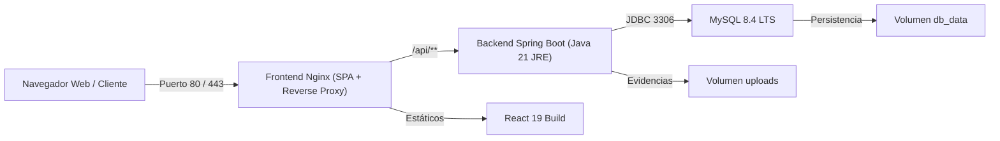

# 10 — Guía de Despliegue en la Nube y Ambientes (Fase III)

Este documento detalla la arquitectura de contenedores, la estrategia de ambientes (Dev / Test / Prod) y los pasos para el despliegue del sistema PGSUF en plataformas Cloud (Render, Railway o VPS con Docker Compose).

---

## 1. Arquitectura de Contenedores

La solución se empaqueta en tres contenedores orquestados mediante `docker-compose.yml`:



### Componentes:
1. **`db` (MySQL 8.4 LTS):** Almacenamiento relacional con healthcheck y volumen persistente `db_data`. Flyway ejecuta automáticamente las migraciones (`V1__esquema.sql`, `V2__datos_iniciales.sql`) al iniciar el backend.
2. **`backend` (Spring Boot 3.5.16, Java 21):** Imagen multi-stage ligera sobre `eclipse-temurin:21-jre-alpine` ejecutándose con usuario sin privilegios (`spring`). Expone el puerto `8080`.
3. **`frontend` (React 19 + TypeScript + Nginx):** Imagen multi-stage construida con Node 22 y servida por Nginx Alpine. Actúa como Reverse Proxy transparente hacia `/api/`, `/swagger-ui/` y `/actuator/`, eliminando problemas de CORS en producción al compartir el mismo origen.

---

## 2. Variables de Entorno por Ambiente

| Variable | Desarrollo (`dev`) | Pruebas (`test` / CI) | Producción (`prod`) |
|---|---|---|---|
| `SPRING_PROFILES_ACTIVE` | `dev` | `test` | `prod` |
| `DB_URL` | `jdbc:mysql://localhost:3306/servicios_universitarios` | `jdbc:mysql://127.0.0.1:3306/servicios_universitarios` | `jdbc:mysql://db:3306/servicios_universitarios` |
| `DB_USER` | `app_servicios` | `app_servicios` | `app_servicios` |
| `DB_PASSWORD` | *(secreto local)* | `app_servicios_pass` | *(secreto gestionado en Cloud)* |
| `JWT_SECRET` | *(Base64 >= 32 bytes)* | *(Base64 >= 32 bytes fija)* | *(Generada con openssl rand -base64 48)* |
| `CORS_ALLOWED_ORIGINS` | `http://localhost:5173` | `http://localhost:5173` | `https://midominio.com` *(sin comodín \*)* |
| `CORS_ALLOW_CREDENTIALS`| `false` | `false` | `false` |
| `UPLOAD_DIR` | `./uploads` | `./uploads` | `/app/uploads` |
| `ADMIN_EMAIL` | `admin@unmsm.edu.pe` | `admin@unmsm.edu.pe` | `admin@unmsm.edu.pe` |
| `ADMIN_PASSWORD` | `Admin123!` | `Admin123!` | *(Contraseña robusta inicial)* |

---

## 3. Despliegue Local con Docker Compose

1. **Crear archivo de entorno:**
   ```bash
   cp .env.example .env
   ```
2. **Generar un `JWT_SECRET` seguro:**
   ```bash
   openssl rand -base64 48
   ```
   *Pegar el valor generado en `JWT_SECRET` dentro de `.env`.*
3. **Construir y levantar los servicios:**
   ```bash
   docker compose up -d --build
   ```
4. **Verificar el estado:**
   ```bash
   docker compose ps
   ```
   - Aplicación Web: `http://localhost` o `http://localhost:5173`
   - Documentación Swagger/OpenAPI: `http://localhost/swagger-ui.html`
   - Healthcheck Actuator: `http://localhost/actuator/health`

---

## 4. Despliegue en la Nube (Opciones recomendadas)

### Opción A: Despliegue en VPS (Ubuntu 22.04 / 24.04 con Docker)
1. Instalar Docker y Docker Compose en el servidor.
2. Clonar el repositorio:
   ```bash
   git clone https://github.com/alejpaa/PGSUF.git
   cd PGSUF
   ```
3. Configurar `.env` con las credenciales de producción y el dominio HTTPS en `CORS_ALLOWED_ORIGINS`.
4. Configurar Nginx / Traefik / Certbot en el host para terminar SSL (HTTPS automático Let's Encrypt).
5. Ejecutar `docker compose up -d --build`.

### Opción B: Despliegue en PaaS (Render / Railway)
- **Base de Datos:** Crear un servicio gestionado de MySQL.
- **Backend Service:**
  - Build context: `./backend`
  - Dockerfile: `./backend/Dockerfile`
  - Configurar las variables de entorno: `DB_URL`, `DB_USER`, `DB_PASSWORD`, `JWT_SECRET`, `SPRING_PROFILES_ACTIVE=prod`, `CORS_ALLOWED_ORIGINS`.
- **Frontend Service:**
  - Build context: `./frontend/app`
  - Dockerfile: `./frontend/app/Dockerfile`
  - Conectar el proxy de Nginx a la URL interna del backend.

---

## 5. Verificación Post-Despliegue

Tras iniciar los servicios en producción, validar:
1. **Salud del Backend:**
   ```bash
   curl -I https://<midominio>/actuator/health
   # Debe responder HTTP 200 {"status":"UP"}
   ```
2. **Swagger / OpenAPI:**
   ```bash
   curl -I https://<midominio>/swagger-ui.html
   # Debe responder HTTP 200 o redirigir a /swagger-ui/index.html
   ```
3. **Flujo de Acceso:**
   - Iniciar sesión con el usuario `admin@unmsm.edu.pe` configurado.
   - Navegar a `/admin` para gestionar catálogos y usuarios.
